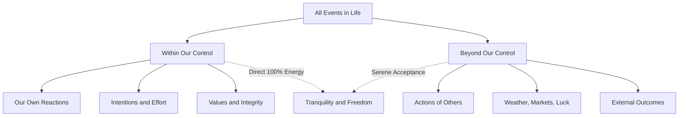

+++
title = "Life #3: Stoic Philosophy and Serenity in an Unsettled World"
slug = "stoicism-and-serenity"
date = '2026-10-16T10:13:00+07:00'
draft = false
tags = ["life", "philosophy", "stoicism", "serenity", "psychology"]
categories = ["Life", "Philosophy"]
description = "Exploring ancient Stoic wisdom: Epictetus's Dichotomy of Control, Amor Fati, and how to maintain tranquility in a turbulent world."
summary = "Stoicism is not the unfeeling suppression of emotion, but the art of mastering one's mind: clearly distinguishing what lies in our control from what does not, to attain inner freedom."
+++

## 1. Misconceptions About "Stoicism"

When people hear the word "Stoic," they often envision an icy figure repressing every emotion, enduring hardship with bitter resignation, completely detached from the joys of living.

This is an unfortunate misunderstanding.

Rooted in ancient Greece and Rome with figures as diverse as the emancipated slave **Epictetus**, the statesman **Seneca**, and the emperor **Marcus Aurelius**, Stoicism is fundamentally a **practical philosophy** oriented toward a single overarching goal: **Attaining inner tranquility (Ataraxia) and living a life of virtue.**

---

## 2. The Central Pillar: The Dichotomy of Control

Epictetus opens his handbook, the *Enchiridion*, with an axiom that has transformed countless lives:

> *"Some things are in our control and others not."*

1. **Things WITHIN our control:**
   - Your thoughts, beliefs, and judgments.
   - Your actions, integrity, and diligence.
   - How you respond to whatever circumstance arises.
2. **Things BEYOND our control:**
   - What other people think of you or how they treat you.
   - Economic cycles, the weather, traffic congestion.
   - An unexpected production server failure late at night caused by an external cloud vendor.
   - Physical illness and the biological mortality of the body.

> **The Core Insight:** The root of human suffering, anxiety, and resentment lies in attempting to control what has never belonged to our sphere of influence, while neglecting to govern the one domain that does: our own mind and reactions.

---

## 3. Three Practical Lessons for Modern Life

### 3.1. Events Are Neutral; Only Our Perspective Imparts Meaning
Marcus Aurelius recorded in his private journal, *Meditations*:
> *"If you are distressed by anything external, the pain is not due to the thing itself, but to your estimate of it; and this you have the power to revoke at any moment."*

A cancelled initiative, a disappointing exam result — the occurrence itself is an objective fact. Whether it represents a "catastrophe" or an "opportunity to adapt and learn" depends entirely on your mental framing.

### 3.2. Amor Fati — Love of One's Fate
Rather than begrudgingly tolerating adversity, a Stoic welcomes trials the way a blacksmith welcomes fire. Fire consumes dry brush, but it tempers iron into steel. Every setback provides raw material to cultivate patience, resilience, and compassion.

### 3.3. Memento Mori — Remember You Must Die
Far from morbid pessimism, contemplating our mortality is the most potent antidote to procrastination and trivial vanity:
- Knowing our days are finite, would we waste hours in bitter online arguments with strangers?
- Would we hold petty grudges against those we love?

---

## 4. Closing Thoughts: The Freedom No One Can Take

Circumstances may strip away wealth, reputation, employment, or even bodily freedom, but no external power can breach the sacred inner citadel between an event and your conscious choice of reaction.

Maintaining equanimity in the face of adversity is neither accidental nor born of luck; it is a spiritual muscle developed daily through mindful awareness and humble resolve.
