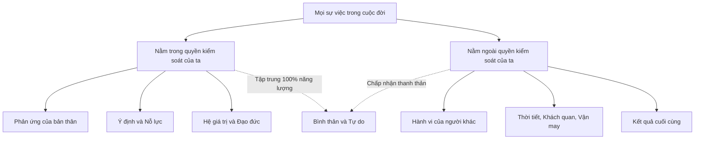

+++
title = "Cuộc Sống #3: Triết học Khắc kỷ (Stoicism) và Sự bình thản giữa dòng đời biến động"
date = '2026-10-16T10:13:00+07:00'
draft = false
tags = ["cuộc sống", "triết học", "stoicism", "khắc kỷ", "bình thản", "tâm lý"]
categories = ["Cuộc sống", "Triết học"]
description = "Khám phá trí tuệ của chủ nghĩa Khắc kỷ cổ đại: Vòng tròn kiểm soát của Epictetus, Amor Fati và cách giữ sự an yên giữa một thế giới đầy biến động khôn lường."
summary = "Triết học Khắc kỷ không phải là kìm nén cảm xúc vô cảm, mà là nghệ thuật làm chủ tâm trí: phân biệt rạch ròi những gì ta có thể kiểm soát và những gì nằm ngoài tầm tay để tìm thấy sự tự do nội tại."
+++

## 1. Sự ngộ nhận về "Khắc kỷ"

Khi nghe đến hai chữ "Khắc kỷ" (Stoicism), nhiều người thường hình dung ra hình ảnh một người đàn ông mặt lạnh như băng, kìm nén mọi xúc cảm, chịu đựng đau khổ một cách cam chịu và vô cảm trước cuộc đời.

Nhưng đó là một sự ngộ nhận đáng tiếc.

Chủ nghĩa Khắc kỷ, bắt nguồn từ Hy Lạp và La Mã cổ đại với những tên tuổi lẫy lừng như vị nô lệ **Epictetus**, nhà quý tộc **Seneca**, và vị hoàng đế tối cao **Marcus Aurelius**, thực chất là một **hệ thống triết học thực hành (Practical Philosophy)** hướng tới một mục tiêu duy nhất: **Đạt được sự bình thản nội tâm (Ataraxia) và sống một cuộc đời có đạo đức trọn vẹn.**

---

## 2. Trụ cột trung tâm: Nhị phân Quyền kiểm soát (Dichotomy of Control)

Nhà hiền triết Epictetus đã mở đầu cuốn cẩm nang *Enchiridion* bằng một tuyên ngôn làm thay đổi cuộc đời của hàng triệu con người:

> *"Trên đời này có những thứ nằm trong quyền kiểm soát của chúng ta, và có những thứ hoàn toàn không nằm trong quyền kiểm soát của chúng ta."*

1. **Những thứ NẰM TRONG quyền kiểm soát:** 
   - Suy nghĩ, phán đoán của chính bạn.
   - Hành động, nỗ lực và sự trung thực của bạn.
   - Cách bạn phản ứng trước một sự kiện xảy đến.
2. **Những thứ NẰM NGOÀI quyền kiểm soát:**
   - Người khác nghĩ gì về bạn hoặc đối xử với bạn ra sao.
   - Thị trường kinh tế, thời tiết, kẹt xe trên đường.
   - Một lỗi hệ thống bất ngờ phát sinh vào đêm khuya do nhà cung cấp dịch vụ bên thứ ba bị sập.
   - Thậm chí là sức khỏe và cái chết của thể xác trong tương lai.

> **Bài học cốt tủy:** Nguồn gốc của mọi đau khổ, lo âu và tức giận của con người xuất phát từ việc chúng ta cố gắng kiểm soát những thứ vốn dĩ không thuộc về quyền kiểm soát của mình, đồng thời lại lơ là kiểm soát chính tâm trí và phản ứng của bản thân!

---

## 3. Ba bài học thực hành cho đời sống hiện đại

### 3.1. Sự kiện là trung tính, chỉ có góc nhìn của ta gán ý nghĩa cho nó
Hoàng đế Marcus Aurelius viết trong cuốn nhật ký *Suy tưởng (Meditations)*:
> *"Nếu bạn đau khổ vì một điều gì đó bên ngoài, nỗi đau đó không phải do chính điều đó gây ra, mà là do sự đánh giá của bạn về nó. Và bạn có quyền xóa bỏ sự đánh giá đó bất kỳ lúc nào."*

Một dự án bị hủy bỏ, một kỳ thi không như ý — bản thân sự kiện đó là một sự thật khách quan. Nó là "thảm họa" hay là "cơ hội để học hỏi và chuyển hướng"? Toàn bộ nằm ở cách diễn giải trong tâm trí bạn.

### 3.2. Amor Fati — Yêu lấy định mệnh
Không chỉ đơn thuần là "chấp nhận số phận" một cách miễn cưỡng, triết gia Khắc kỷ đón nhận mọi trắc trở như một người thợ rèn đón nhận ngọn lửa: Ngọn lửa thiêu rụi cành củi khô, nhưng lại tôi luyện thanh sắt thành thép cứng. Mỗi biến cố là một nguyên liệu để rèn luyện đức tính kiên nhẫn và lòng vị tha.

### 3.3. Memento Mori — Luôn nhớ rằng mình sẽ chết
Nghe có vẻ bi quan, nhưng chiêm nghiệm về cái chết chính là liều thuốc giải độc mạnh mẽ nhất cho thói trì hoãn và những toan tính vụn vặt:
- Nếu biết cuộc đời hữu hạn, liệu ta có còn phí thời gian tranh cãi gay gắt với một người lạ trên mạng?
- Liệu ta có còn giận hờn những chuyện nhỏ nhặt với những người thân yêu?

---

## 4. Lời kết: Sự tự do không ai cướp được

Người đời có thể tước đoạt tiền tài, danh vị, công việc hay thậm chí là sự tự do thể xác của bạn, nhưng không một ai trên thế gian này có thể xâm phạm vào không gian nội tâm giữa một sự kiện xảy ra và phản ứng của bạn trước nó.

Giữ vững được sự bình thản trước nghịch cảnh không phải là may mắn trời ban, mà là một cơ bắp tinh thần cần được rèn luyện mỗi ngày thông qua sự tỉnh thức và lòng khiêm nhường.
