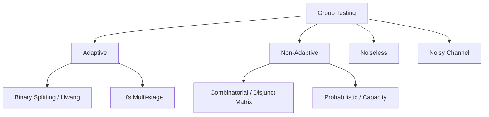

+++
title = "Group Testing #1: Overview and the Classical Dorfman Pooling Model"
slug = "overview-dorfman-pooling"
date = '2026-10-16T10:00:00+07:00'
draft = true
tags = ["group-testing", "dorfman", "probability", "mathematics", "pooled-testing"]
categories = ["Mathematics", "Group Testing"]
math = true
description = "An introduction to the history, mathematical modeling, and probabilistic analysis of pooled testing proposed by Robert Dorfman in 1943."
summary = "Exploring Group Testing from its World War II roots: the two-stage Dorfman model, expected number of tests, optimal pool size derivation, and taxonomy of modern variants."
+++

## 1. Introduction: The Intuition Behind "Group Testing"

Imagine you possess $N = 100{,}000$ blood samples from military recruits and must identify every individual infected with a rare pathogen whose prevalence rate is roughly $p = 1\%$.

If you test each specimen individually:
- You must perform exactly $100{,}000$ diagnostic assays.
- The expenditure in chemical reagents, lab personnel, and turnaround time is immense.

The natural question emerges: **Can we combine (pool) multiple samples together and evaluate them in a single diagnostic test?**
- If the pooled test returns **negative**, every individual constituent in that pool is healthy $\rightarrow$ a single test clears the entire group!
- If the pooled test returns **positive**, the group contains at least one defective sample, at which point deeper investigation is warranted.

This elegant concept forms the cornerstone of **Group Testing (Pooled Testing)**.

---

## 2. Historical Context: Robert Dorfman's Problem (1943)

In 1943, during World War II, American economist and statistician **Robert Dorfman** published a foundational paper in *The Annals of Mathematical Statistics*:
> *"The Detection of Defective Members of Large Populations."*

The United States military needed to screen millions of inducted soldiers for syphilis before deployment. Chemical reagents were in critically short supply. Dorfman formulated a two-stage pooled testing procedure that saved substantial medical resources.

---

## 3. Formal Mathematical Model

Consider a population of $N$ items indexed from $1$ to $N$:
- Each item $j$ has a binary state $x_j \in \{0, 1\}$, where:
  - $x_j = 0$: The item is normal (non-defective / negative).
  - $x_j = 1$: The item is defective (infected / positive).
- State vector: $\mathbf{x} = (x_1, x_2, \dots, x_N)^T \in \{0, 1\}^N$.
- The total count of defective items is $d = \|\mathbf{x}\|_0 = \sum_{j=1}^N x_j$. In many real-world settings, $d \ll N$ (sparsity).

A group test on a subset $S \subseteq \{1, 2, \dots, N\}$ returns a binary measurement $y \in \{0, 1\}$ according to the Boolean OR operator:

$$
y = \bigvee_{j \in S} x_j = 
\begin{cases} 
0, & \text{if } x_j = 0 \quad \forall j \in S \\
1, & \text{if } \exists j \in S \text{ such that } x_j = 1 
\end{cases}
$$

Core objective: **Accurately reconstruct vector $\mathbf{x}$ using the minimum number of tests $T$ ($T \ll N$).**

---

## 4. Mathematical Analysis of Dorfman's Two-Stage Scheme

Dorfman formulated the following two-stage procedure:
1. **Stage 1 (Pooling):** Partition the $N$ specimens into disjoint groups of equal size $k$. The number of groups is $N/k$ (assuming $k$ divides $N$). Perform one test per group.
2. **Stage 2 (Individual Confirmation):**
   - For any group testing negative, declare all $k$ items negative.
   - For any group testing positive, test each of the $k$ members individually (requiring $k$ additional tests).

### 4.1. Expected Number of Tests $E[T]$

Assume the infection statuses of items are independent and identically distributed (i.i.d.) with defect probability $p \in (0, 1)$:

- Probability that a single item is negative: $1 - p$.
- Probability that all $k$ items in a pool are negative: $(1 - p)^k$.
- Probability that a pool tests **positive**:
  $$P(\text{positive pool}) = 1 - (1 - p)^k$$

For a single pool of size $k$, the random variable $T_g$ representing tests consumed is:
$$
T_g = \begin{cases}
1, & \text{with probability } (1 - p)^k \\
1 + k, & \text{with probability } 1 - (1 - p)^k
\end{cases}
$$

Hence, the expected test count for a single group is:
$$
E[T_g] = 1 \cdot (1 - p)^k + (1 + k) \left[ 1 - (1 - p)^k \right] = 1 + k \left[ 1 - (1 - p)^k \right]
$$

Across all $N/k$ groups, total expected tests is:
$$
E[T] = \frac{N}{k} \cdot E[T_g] = N \left[ \frac{1}{k} + 1 - (1 - p)^k \right]
$$

The ratio of tests relative to individual screening represents the efficiency function:
$$
f(k, p) = \frac{E[T]}{N} = \frac{1}{k} + 1 - (1 - p)^k
$$

### 4.2. Finding the Optimal Pool Size $k^*$

To minimize $E[T]$, we find $k$ minimizing $f(k, p)$.

When prevalence $p$ is small ($p \to 0$), applying a Taylor expansion yields:
$$
(1 - p)^k \approx 1 - kp + \frac{k(k-1)}{2} p^2 \approx 1 - kp
$$
To second order:
$$
f(k, p) \approx \frac{1}{k} + kp
$$
Differentiating with respect to $k$ and setting to $0$:
$$
f'(k) = -\frac{1}{k^2} + p = 0 \implies k^* \approx \frac{1}{\sqrt{p}}
$$

Under this optimal group size, the test ratio scales approximately as:
$$
f(k^*, p) \approx \sqrt{p} + \frac{p}{\sqrt{p}} = 2\sqrt{p}
$$

### 4.3. Empirical Comparison

| Prevalence $p$ | Optimal Pool Size $k^*$ | Test Ratio $E[T]/N$ | Resource Savings (%) |
| :---: | :---: | :---: | :---: |
| $1\%$ ($0.01$) | $11$ | $\approx 0.196$ | **$80.4\%$** |
| $0.5\%$ ($0.005$) | $15$ | $\approx 0.139$ | **$86.1\%$** |
| $0.1\%$ ($0.001$) | $32$ | $\approx 0.063$ | **$93.7\%$** |
| $5\%$ ($0.05$) | $5$ | $\approx 0.426$ | **$57.4\%$** |
| $20\%$ ($0.20$) | $3$ | $\approx 0.821$ | **$17.9\%$** |

> **Key Observation:** When prevalence exceeds $p > 30\%$, Dorfman pooling offers virtually no savings over individual testing. Group testing achieves its greatest power when data exhibits sparsity ($p \ll 1$).

---

## 5. Taxonomy of Modern Group Testing

From Dorfman's foundational model, Group Testing has evolved into a vibrant domain spanning discrete mathematics, probability, and theoretical computer science:

1. **Adaptive vs. Non-Adaptive:**
   - **Adaptive:** Subsequent tests depend on the outcomes of earlier tests (minimizes total tests, but introduces sequential latency).
   - **Non-Adaptive:** The complete testing matrix is fixed beforehand, enabling fully parallel execution.
2. **Combinatorial vs. Probabilistic:**
   - **Combinatorial:** Guarantees zero-error recovery for any configuration of $d$ defectives.
   - **Probabilistic:** Guarantees successful recovery with high probability ($1 - \epsilon$).
3. **Noiseless vs. Noisy:**
   - **Noiseless:** Measurement outcomes are strictly deterministic.
   - **Noisy:** Channel noise introduces false positives or false negatives.

---

## 6. Summary and Next Steps

Dorfman's model stands as an elegant showcase of applied probability: a simple pooling strategy yields savings exceeding $80\%-90\%$ in practice.

In [Article 2: Adaptive Group Testing and Hwang's Algorithm](../adaptive-group-testing-hwang/), we explore the information-theoretic lower bounds and Hwang's asymptotically optimal binary splitting algorithm.

---

## 7. References

1. **Dorfman, R. (1943).** *The detection of defective members of large populations.* The Annals of Mathematical Statistics, 14(4), 436-440.
2. **Du, D. Z., & Hwang, F. K. (2000).** *Combinatorial group testing and its applications* (Vol. 12). World Scientific.
3. **Aldridge, M., Johnson, O., & Scarlett, J. (2019).** *Group testing: an information theory perspective.* Foundations and Trends in Communications and Information Theory, 15(3-4), 196-392.
