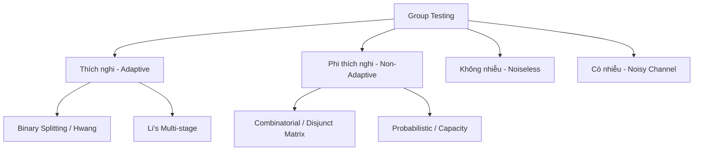

+++
title = "Group Testing #1: Tổng quan và Mô hình gộp mẫu kinh điển của Dorfman"
slug = "tong-quan-kiem-thu-nhom-va-mo-hinh-dorfman"
date = '2026-10-16T10:00:00+07:00'
draft = true
tags = ["group testing", "dorfman", "xác suất", "toán học", "pooled testing"]
categories = ["Toán học", "Group Testing"]
math = true
description = "Giới thiệu lịch sử, mô hình toán học và phân tích xác suất của phương pháp xét nghiệm gộp mẫu (pooled testing) do Robert Dorfman đề xuất năm 1943."
summary = "Khám phá bài toán kiểm thử nhóm (Group Testing) từ nguồn gốc Thế chiến II: mô hình Dorfman hai giai đoạn, công thức kỳ vọng số phép thử, bài toán tối ưu kích thước nhóm mẫu và phân loại các biến thể hiện đại."
+++

## 1. Lời mở đầu: Trực giác đằng sau "Kiểm thử nhóm"

Hãy tưởng tượng bạn có $N = 100{,}000$ mẫu máu của các tân binh và cần phát hiện những người bị nhiễm một căn bệnh hiếm gặp với tỷ lệ nhiễm bệnh chỉ khoảng $p = 1\%$. 

Nếu kiểm tra từng mẫu riêng lẻ:
- Bạn sẽ phải thực hiện đúng $100{,}000$ xét nghiệm.
- Chi phí hóa chất, nhân lực và thời gian chờ đợi sẽ là khổng lồ.

Câu hỏi đặt ra là: **Liệu chúng ta có thể trộn (gộp) nhiều mẫu lại với nhau và kiểm tra chung trong một lần xét nghiệm hay không?** 
- Nếu kết quả của nhóm là **âm tính (negative)**, toàn bộ các mẫu trong nhóm đó đều sạch bệnh $\rightarrow$ chỉ cần 1 xét nghiệm để kết luận cho cả nhóm!
- Nếu kết quả là **dương tính (positive)**, nhóm đó có ít nhất một mẫu nhiễm bệnh, khi đó ta mới cần kiểm tra sâu hơn.

Ý tưởng thanh lịch này chính là nền móng của lĩnh vực **Group Testing (Kiểm thử nhóm / Xét nghiệm gộp)**.

---

## 2. Bối cảnh lịch sử: Bài toán Robert Dorfman (1943)

Năm 1943, trong thời kỳ Thế chiến thứ II, nhà kinh tế học và thống kê người Mỹ **Robert Dorfman** đã công bố một bài báo mang tính bước ngoặt trên tạp chí *The Annals of Mathematical Statistics*: 
> *"The Detection of Defective Members of Large Populations"* (Phát hiện các phần tử lỗi trong quần thể lớn).

Quân đội Mỹ khi đó cần sàng lọc bệnh giang mai (syphilis) cho hàng triệu binh sĩ trước khi điều động. Hóa chất xét nghiệm thời bấy giờ vô cùng khan hiếm. Dorfman đã đề xuất chiến lược xét nghiệm hai giai đoạn (two-stage pooled testing) giúp tiết kiệm đáng kể nguồn lực y tế.

---

## 3. Mô hình toán học hình thức

Giả sử quần thể gồm $N$ cá thể được đánh số từ $1$ đến $N$:
- Mỗi cá thể $j$ có trạng thái $x_j \in \{0, 1\}$, trong đó:
  - $x_j = 0$: Cá thể bình thường (không lỗi / âm tính).
  - $x_j = 1$: Cá thể bị lỗi (mắc bệnh / dương tính).
- Vector trạng thái toàn thể: $\mathbf{x} = (x_1, x_2, \dots, x_N)^T \in \{0, 1\}^N$.
- Số lượng mẫu dương tính là $d = \|\mathbf{x}\|_0 = \sum_{j=1}^N x_j$. Trong nhiều ứng dụng thực tế, $d \ll N$ (tính chất thưa thớt - *sparsity*).

Một phép thử nhóm trên tập con $S \subseteq \{1, 2, \dots, N\}$ trả về kết quả nhị phân $y \in \{0, 1\}$ theo phép toán Boolean OR:

$$
y = \bigvee_{j \in S} x_j = 
\begin{cases} 
0, & \text{nếu } x_j = 0 \quad \forall j \in S \\
1, & \text{nếu } \exists j \in S \text{ sao cho } x_j = 1 
\end{cases}
$$

Mục tiêu cốt lõi: **Xác định chính xác vector $\mathbf{x}$ bằng số lượng phép thử $T$ nhỏ nhất có thể ($T \ll N$).**

---

## 4. Phân tích toán học chiến lược Dorfman 2 giai đoạn

Dorfman đề xuất thuật toán hai giai đoạn như sau:
1. **Giai đoạn 1 (Gộp nhóm):** Chia $N$ mẫu thành các nhóm bằng nhau, mỗi nhóm có kích thước $k$. Số nhóm là $N/k$ (giả sử $N$ chia hết cho $k$). Thực hiện 1 phép thử cho mỗi nhóm.
2. **Giai đoạn 2 (Kiểm tra cá nhân):** 
   - Với những nhóm có kết quả âm tính, ta kết luận tất cả $k$ mẫu đều âm tính.
   - Với những nhóm có kết quả dương tính, ta kiểm tra riêng lẻ từng mẫu trong nhóm đó (cần thêm $k$ phép thử).

### 4.1. Kỳ vọng số phép thử $E[T]$

Giả sử trạng thái mắc bệnh của các cá thể là độc lập và cùng phân phối (i.i.d.) với xác suất mắc bệnh là $p \in (0, 1)$:

- Xác suất để một mẫu bất kỳ là âm tính: $1 - p$.
- Xác suất để toàn bộ $k$ mẫu trong một nhóm đều âm tính: $(1 - p)^k$.
- Xác suất để một nhóm có kết quả **dương tính**: 
  $$P(\text{nhóm dương tính}) = 1 - (1 - p)^k$$

Xét một nhóm kích thước $k$, số phép thử ngẫu nhiên $T_g$ cần dùng cho nhóm này là:
$$
T_g = \begin{cases}
1, & \text{với xác suất } (1 - p)^k \\
1 + k, & \text{với xác suất } 1 - (1 - p)^k
\end{cases}
$$

Do đó, kỳ vọng số phép thử cho một nhóm là:
$$
E[T_g] = 1 \cdot (1 - p)^k + (1 + k) \left[ 1 - (1 - p)^k \right] = 1 + k \left[ 1 - (1 - p)^k \right]
$$

Tổng kỳ vọng số phép thử cho toàn bộ $N/k$ nhóm là:
$$
E[T] = \frac{N}{k} \cdot E[T_g] = N \left[ \frac{1}{k} + 1 - (1 - p)^k \right]
$$

Tỷ lệ số phép thử so với phương pháp thông thường là hàm hiệu suất:
$$
f(k, p) = \frac{E[T]}{N} = \frac{1}{k} + 1 - (1 - p)^k
$$

### 4.2. Tìm kích thước nhóm tối ưu $k^*$

Để giảm thiểu $E[T]$, ta cần tìm $k$ sao cho hàm $f(k, p)$ đạt giá trị nhỏ nhất.

Khi $p$ rất nhỏ ($p \to 0$), áp dụng xấp xỉ khai triển Taylor:
$$
(1 - p)^k \approx 1 - kp + \frac{k(k-1)}{2} p^2 \approx 1 - kp
$$
Khi lấy bậc 2:
$$
f(k, p) \approx \frac{1}{k} + kp
$$
Lấy đạo hàm theo $k$ và cho bằng $0$:
$$
f'(k) = -\frac{1}{k^2} + p = 0 \implies k^* \approx \frac{1}{\sqrt{p}}
$$

Khi đó, tỷ lệ phép thử tối ưu đạt xấp xỉ:
$$
f(k^*, p) \approx \sqrt{p} + \frac{p}{\sqrt{p}} = 2\sqrt{p}
$$

### 4.3. Bảng so sánh thực tế

| Tỷ lệ nhiễm bệnh $p$ | Kích thước nhóm tối ưu $k^*$ | Tỷ lệ kiểm tra $E[T]/N$ | Mức độ tiết kiệm (%) |
| :---: | :---: | :---: | :---: |
| $1\%$ ($0.01$) | $11$ | $\approx 0.196$ | **$80.4\%$** |
| $0.5\%$ ($0.005$) | $15$ | $\approx 0.139$ | **$86.1\%$** |
| $0.1\%$ ($0.001$) | $32$ | $\approx 0.063$ | **$93.7\%$** |
| $5\%$ ($0.05$) | $5$ | $\approx 0.426$ | **$57.4\%$** |
| $20\%$ ($0.20$) | $3$ | $\approx 0.821$ | **$17.9\%$** |

> **Nhận xét quan trọng:** Khi $p > 30\%$, phương pháp Dorfman gần như không còn tiết kiệm được phép thử nào so với kiểm tra đơn lẻ. Group Testing phát huy sức mạnh tối đa khi dữ liệu có tính chất thưa (sparse, tức $p$ nhỏ).

---

## 5. Bản đồ phân loại bài toán Group Testing hiện đại

Từ ý tưởng sơ khai của Dorfman, lĩnh vực Group Testing đã phát triển thành một nhánh toán học và khoa học máy tính đa dạng:

1. **Adaptive vs. Non-Adaptive:**
   - **Adaptive (Thích nghi):** Các test tiếp theo phụ thuộc vào kết quả của các test trước (tối ưu số test, nhưng độ trễ cao).
   - **Non-Adaptive (Phi thích nghi):** Toàn bộ thiết kế các phép thử được cố định từ đầu và có thể chạy song song đồng thời.
2. **Combinatorial vs. Probabilistic:**
   - **Combinatorial:** Đảm bảo đúng 100% cho mọi tập con $d$ phần tử lỗi.
   - **Probabilistic:** Đảm bảo giải mã đúng với xác suất cao ($1 - \epsilon$).
3. **Noiseless vs. Noisy:**
   - **Noiseless:** Kết quả test chính xác tuyệt đối.
   - **Noisy:** Có xác suất xảy ra âm tính giả hoặc dương tính giả.

---

## 6. Lời kết và Hướng dẫn bài tiếp theo

Phương pháp của Dorfman là một minh chứng tuyệt vời cho vẻ đẹp của xác suất ứng dụng: một tư duy gộp mẫu đơn giản có thể tiết kiệm tới $90\%$ chi phí trong thực tế.

Trong **[Bài 2: Kiểm thử thích nghi (Adaptive Group Testing) và Thuật toán Hwang](../kiem-thu-thich-nghi-binary-splitting-va-hwang/)**, chúng ta sẽ khám phá giới hạn cận dưới của lý thuyết thông tin và thuật toán chia nhị phân đạt tiệm cận tối ưu của Hwang.

---

## 7. Tài liệu tham khảo

1. **Dorfman, R. (1943).** *The detection of defective members of large populations.* The Annals of Mathematical Statistics, 14(4), 436-440.
2. **Du, D. Z., & Hwang, F. K. (2000).** *Combinatorial group testing and its applications* (Vol. 12). World Scientific.
3. **Aldridge, M., Johnson, O., & Scarlett, J. (2019).** *Group testing: an information theory perspective.* Foundations and Trends® in Communications and Information Theory, 15(3-4), 196-392.
