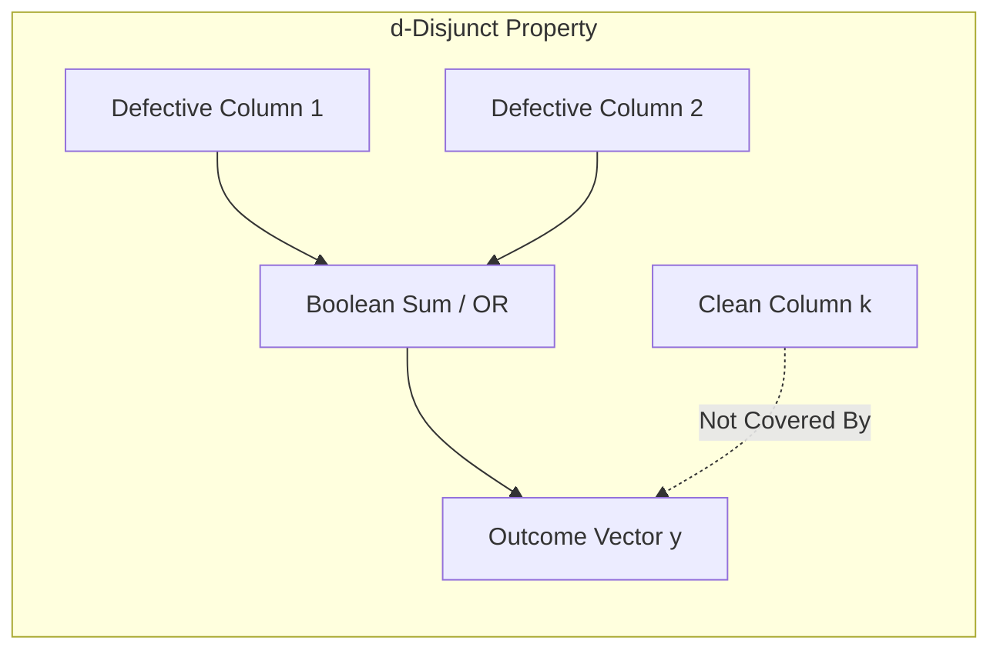

+++
title = "Group Testing #3: Non-Adaptive Group Testing and Disjunct Matrices"
date = '2026-10-16T10:10:00+07:00'
draft = true
tags = ["group-testing", "non-adaptive", "disjunct-matrix", "combinatorics", "matrices"]
categories = ["Mathematics", "Group Testing"]
math = true
description = "Investigating the algebraic foundation of Non-Adaptive Group Testing (NAGT), defining d-disjunct matrices, and exploring probabilistic and deterministic constructions."
summary = "Exploring single-stage parallel test designs: Boolean binary matrix representations, unique identifiability (d-separable), d-disjunct properties, and Kautz-Singleton constructions."
+++

## 1. Why Non-Adaptive Group Testing Is Crucial in Practice

In our previous discussion, we saw that Hwang's adaptive algorithm is exceptionally parsimonious in test counts but imposes significant latency: each test must wait for prior outcomes.

In high-throughput industrial and clinical environments:
- Automated robotic PCR analyzers operate with 96-well or 384-well microplates.
- Liquid handling robots perform best when pipetting protocols are known in advance.
- All wells are processed simultaneously in a single thermal cycling run (consuming exactly 1 machine cycle).

This operational reality drives **Non-Adaptive Group Testing (NAGT)**: *All pooled tests are designed independently beforehand and executed simultaneously in a single round.*

---

## 2. Algebraic Formulation and the Incidence Matrix

A non-adaptive design comprising $t$ tests across $N$ candidate items is represented by a binary incidence matrix:

$$
\mathbf{M} \in \{0, 1\}^{t \times N} = 
\begin{pmatrix}
M_{11} & M_{12} & \dots & M_{1N} \\
M_{21} & M_{22} & \dots & M_{2N} \\
\vdots & \vdots & \ddots & \vdots \\
M_{t1} & M_{t2} & \dots & M_{tN}
\end{pmatrix}
$$

Where:
- $M_{ij} = 1$: Item $j$ is included in test $i$.
- $M_{ij} = 0$: Item $j$ is excluded from test $i$.
- Column $\mathbf{m}_j \in \{0, 1\}^t$ represents the unique signature (fingerprint) of item $j$ across all tests.
- Row $i$ identifies the subset of items pooled into test $i$.

### Boolean Matrix-Vector Multiplication

Let $\mathbf{x} \in \{0, 1\}^N$ denote the population status vector (with at most $d$ non-zero entries). The measurement outcome vector $\mathbf{y} \in \{0, 1\}^t$ is governed by Boolean matrix multiplication:

$$
\mathbf{y} = \mathbf{M} \odot \mathbf{x}
$$

Evaluated component-wise as:
$$
y_i = \bigvee_{j=1}^N (M_{ij} \land x_j) = \bigvee_{j: x_j = 1} M_{ij}
$$

In other words: **The test result vector $\mathbf{y}$ is precisely the Boolean sum (bitwise OR) of the columns corresponding to the defective items!**

---

## 3. Structural Properties: $d$-Separable and $d$-Disjunct Matrices

What mathematical properties must matrix $\mathbf{M}$ satisfy to ensure unambiguous recovery of $\mathbf{x}$ from measurement $\mathbf{y}$?

### 3.1. $d$-Separable Matrices (Unique Identifiability)

> **Definition ($d$-separable):** A matrix $\mathbf{M}$ is said to be $d$-separable if for any pair of distinct defective subsets $S_1, S_2 \subseteq \{1, 2, \dots, N\}$ with $|S_1|, |S_2| \le d$ and $S_1 \neq S_2$, their Boolean sums are distinct:
> $$
> \bigvee_{j \in S_1} \mathbf{m}_j \neq \bigvee_{j \in S_2} \mathbf{m}_j
> $$

If $\mathbf{M}$ is $d$-separable, each defective configuration produces a unique outcome vector $\mathbf{y}$, ensuring theoretical identifiability. However, decoding arbitrary $d$-separable matrices is generally NP-hard.

### 3.2. $d$-Disjunct Matrices (Zero-False-Drop Property)

To guarantee exact decoding with polynomial or linear computational complexity, combinatorialists introduced a stronger property: **the Disjunct condition**.

> **Definition ($d$-disjunct):** A matrix $\mathbf{M}$ is $d$-disjunct if the Boolean sum of any $d$ columns does **not cover** any other $(d+1)$-th column.
> 
> Formally, for every subset $S \subseteq \{1, \dots, N\}$ with $|S| \le d$ and every element $k \notin S$:
> $$
> \mathbf{m}_k \not\subseteq \bigvee_{j \in S} \mathbf{m}_j
> $$
> That is, there always exists at least one row $i$ where $M_{ik} = 1$ while $M_{ij} = 0$ for all $j \in S$.

> **Golden Consequence:** If $\mathbf{M}$ is $d$-disjunct, an item $k$ is certified clean ($x_k = 0$) if its signature $\mathbf{m}_k$ contains a $1$ at any position where outcome vector $\mathbf{y}$ is $0$!

---

## 4. Constructions of Disjunct Matrices

How do we construct $d$-disjunct matrices with the minimum possible row count $t$?

### 4.1. Probabilistic Method (Random Bernoulli Ensemble)

Generate entries independently as $M_{ij} \sim \text{Bernoulli}(p)$:
$$
P(M_{ij} = 1) = p, \quad P(M_{ij} = 0) = 1 - p
$$
- For a row to distinguish column $k$ from a defective set $S$ ($|S| = d$), we require: $M_{ik} = 1$ and $M_{ij} = 0$ for all $j \in S$.
- The probability of this event is $q = p(1 - p)^d$.
- Maximizing $q$ yields the optimal density $p^* = \frac{1}{d + 1}$, where $q^* \approx \frac{1}{e \cdot d}$.

Applying the probabilistic method and a Union Bound demonstrates that:
$$
t = O(d^2 \log N)
$$
random tests suffice for $\mathbf{M}$ to be $d$-disjunct with probability approaching 1.

### 4.2. Explicit Algebraic Construction: Kautz & Singleton (1964)

William H. Kautz and Roy R. Singleton devised an algebraic construction leveraging **Reed-Solomon (RS) error-correcting codes** over finite fields $\mathbb{F}_q$:

1. Select a finite field $\mathbb{F}_q$ where $q > d$.
2. Map each item $j \in \{1, \dots, N\}$ to a polynomial of degree at most $k-1$ over $\mathbb{F}_q$:
   $$P_j(z) = a_0 + a_1 z + \dots + a_{k-1} z^{k-1}$$
   Total polynomials available is $q^k = N \implies k = \lceil \log_q N \rceil$.
3. Evaluate the polynomial across all $q$ elements of $\mathbb{F}_q$: $\big(P_j(\alpha_1), \dots, P_j(\alpha_q)\big)$.
4. Encode each evaluation value into a 1-hot binary vector of length $q$.
5. The resulting matrix has $t = q^2$ rows.

Since two distinct polynomials of degree $k-1$ intersect at no more than $k-1$ points, the inner product between any two columns is bounded above by $k-1$. Setting parameters such that $(k-1)d < q$ guarantees that the resulting matrix is strictly $d$-disjunct!

---

## 5. Bounds on Measurement Counts in NAGT

| Matrix Class | Lower Bound | Upper Bound Achieved |
| :--- | :--- | :--- |
| **$d$-separable** | $\Omega\left(\frac{d^2 \log N}{\log d}\right)$ | $O(d^2 \log N)$ |
| **$d$-disjunct** | $\Omega\left(\frac{d^2 \log N}{\log d}\right)$ | $O(d^2 \log N)$ (Random) / $O(d^2 \log^2 N)$ (Explicit) |
| **Probabilistic NAGT** (tolerating error $\epsilon$) | $\Omega(d \log(N/d))$ | $O(d \log N)$ |

> **Crucial Takeaway:** Guaranteeing zero error in the worst case with disjunct matrices requires test scaling quadratic in $d$ ($t = O(d^2 \log N)$). However, if an infinitesimal probability of error $\epsilon > 0$ is acceptable, the required test count drops to $O(d \log N)$!

---

## 6. Summary

Disjunct matrices provide the mathematical engine that transforms non-adaptive testing into practical reality. In our next article, we examine efficient decoding algorithms to reconstruct defective vectors from measurement outcomes.

---

## 7. References

1. **Kautz, W., & Singleton, R. (1964).** *Nonrandom binary codes in nonadaptive group testing.* IEEE Transactions on Information Theory, 10(4), 363-377.
2. **Porat, E., & Rothschild, A. (2011).** *Explicit nonadaptive combinatorial group testing schemes.* IEEE Transactions on Information Theory, 57(12), 7982-7989.
3. **Du, D. Z., & Hwang, F. K. (2000).** *Combinatorial Group Testing and Its Applications.* World Scientific.
