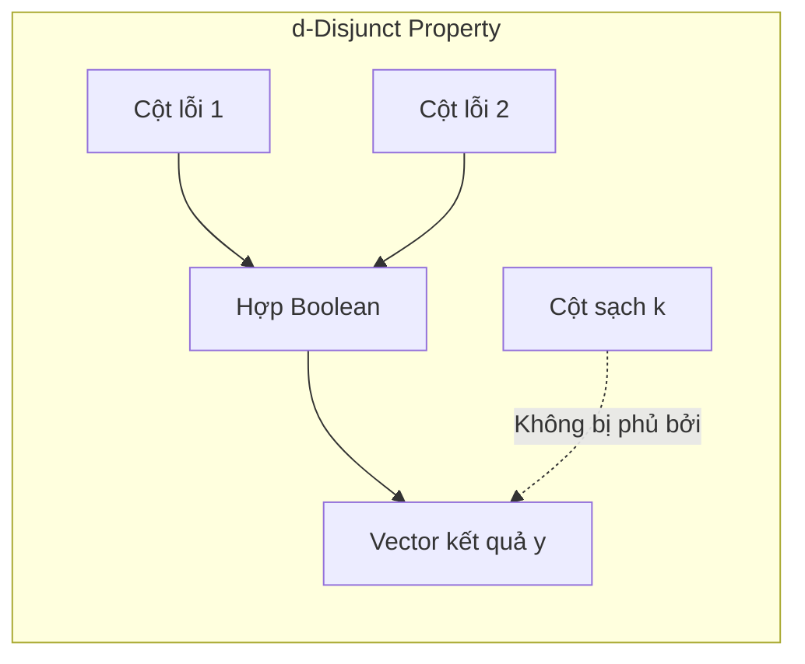

+++
title = "Group Testing #3: Kiểm thử phi thích nghi (Non-Adaptive Group Testing) và Ma trận Disjunct"
slug = "kiem-thu-phi-thich-nghi-va-ma-tran-disjunct"
date = '2026-10-16T10:10:00+07:00'
draft = true
tags = ["group testing", "non-adaptive", "disjunct matrix", "đại số tổ hợp", "ma trận"]
categories = ["Toán học", "Group Testing"]
math = true
description = "Đi sâu vào mô hình đại số của Kiểm thử phi thích nghi (NAGT), định nghĩa ma trận d-disjunct và các phương pháp xây dựng ma trận từ đại số hữu hạn và xác suất."
summary = "Khám phá cách thiết kế các phép thử chạy song song 1 giai đoạn: biểu diễn ma trận nhị phân Boolean, điều kiện phân tách duy nhất (d-separable), tính chất d-disjunct và phương pháp Kautz-Singleton."
+++

## 1. Tại sao phi thích nghi (Non-Adaptive) lại là chén thánh trong thực tế?

Ở bài viết trước, chúng ta thấy thuật toán thích nghi của Hwang rất tiết kiệm phép thử nhưng lại có độ trễ lớn: mỗi lần kiểm tra phải chờ có kết quả mới làm tiếp.

Trong môi trường công nghiệp hoặc y tế:
- Máy xét nghiệm PCR tự động vận hành theo khay 96 giếng (96-well plate) hoặc 384 giếng.
- Robot hút mẫu vận hành tối ưu nhất khi biết trước sơ đồ phân phối mẫu vào các giếng.
- Chạy toàn bộ các giếng trong một lần vận hành lò ủ nhiệt duy nhất (chỉ mất $1$ chu kỳ máy).

Đây chính là động lực khai sinh **Kiểm thử phi thích nghi (Non-Adaptive Group Testing - NAGT)**: *Toàn bộ các phép thử được thiết kế độc lập từ trước và tiến hành đồng thời trong 1 giai đoạn duy nhất.*

---

## 2. Mô hình đại số và Ma trận đo (Incidence Matrix)

Một thiết kế phi thích nghi gồm $t$ phép thử trên $N$ vật phẩm có thể được biểu diễn hoàn hảo bởi một ma trận nhị phân:

$$
\mathbf{M} \in \{0, 1\}^{t \times N} = 
\begin{pmatrix}
M_{11} & M_{12} & \dots & M_{1N} \\
M_{21} & M_{22} & \dots & M_{2N} \\
\vdots & \vdots & \ddots & \vdots \\
M_{t1} & M_{t2} & \dots & M_{tN}
\end{pmatrix}
$$

Trong đó:
- $M_{ij} = 1$: Mẫu thứ $j$ được đưa vào phép thử thứ $i$.
- $M_{ij} = 0$: Mẫu thứ $j$ không tham gia phép thử thứ $i$.
- Cột $\mathbf{m}_j \in \{0, 1\}^t$ biểu diễn chữ ký (signature / fingerprint) của mẫu $j$ qua các phép thử.
- Hàng thứ $i$ biểu diễn tập hợp mẫu tham gia vào test thứ $i$.

### Phép nhân ma trận Boolean

Gọi $\mathbf{x} \in \{0, 1\}^N$ là vector trạng thái của $N$ mẫu (với tối đa $d$ phần tử bằng $1$). Kết quả của $t$ phép thử là vector $\mathbf{y} \in \{0, 1\}^t$, được xác định bởi phép nhân ma trận Boolean:

$$
\mathbf{y} = \mathbf{M} \odot \mathbf{x}
$$

với quy tắc:
$$
y_i = \bigvee_{j=1}^N (M_{ij} \land x_j) = \bigvee_{j: x_j = 1} M_{ij}
$$

Nói cách khác: **Vector kết quả $\mathbf{y}$ chính là hợp Boolean (Boolean sum / bitwise OR) của tất cả các cột tương ứng với các phần tử bị lỗi!**

---

## 3. Tính chất cấu trúc: Ma trận $d$-separable và $d$-disjunct

Để có thể khôi phục được vector $\mathbf{x}$ từ kết quả đo $\mathbf{y}$, ma trận $\mathbf{M}$ cần thỏa mãn những điều kiện toán học nào?

### 3.1. Ma trận $d$-separable (Phân tách duy nhất)

> **Định nghĩa ($d$-separable):** Một ma trận $\mathbf{M}$ được gọi là $d$-separable (kí hiệu $\bar{d}$-separable) nếu với mọi cặp tập con phân biệt $S_1, S_2 \subseteq \{1, 2, \dots, N\}$ có kích thước tối đa $d$ ($|S_1|, |S_2| \le d$ và $S_1 \neq S_2$), ta có:
> $$
> \bigvee_{j \in S_1} \mathbf{m}_j \neq \bigvee_{j \in S_2} \mathbf{m}_j
> $$

Nếu $\mathbf{M}$ là $d$-separable, thì mỗi tập lỗi có một vector kết quả $\mathbf{y}$ duy nhất $\implies$ Về mặt lý thuyết, việc giải mã là khả thi. Tuy nhiên, việc tìm lại $S$ từ $\mathbf{y}$ đối với ma trận $d$-separable tổng quát có thể là bài toán NP-hard.

### 3.2. Ma trận $d$-disjunct (Zero-false-drop)

Để giải mã vừa chính xác vừa có thời gian tính toán nhanh (thời gian đa thức hoặc tuyến tính), các nhà toán học đưa ra một tính chất mạnh hơn: **tính chất Disjunct**.

> **Định nghĩa ($d$-disjunct):** Ma trận $\mathbf{M}$ được gọi là $d$-disjunct nếu hợp Boolean của bất kỳ $d$ cột nào cũng **không phủ (not contain / not cover)** bất kỳ cột thứ $d+1$ nào khác.
> 
> Nói cách khác, với mọi tập chỉ số $S \subseteq \{1, \dots, N\}$ có $|S| \le d$ và mọi phần tử $k \notin S$:
> $$
> \mathbf{m}_k \not\subseteq \bigvee_{j \in S} \mathbf{m}_j
> $$
> Tức là luôn tồn tại ít nhất một hàng $i$ sao cho: $M_{ik} = 1$ nhưng $M_{ij} = 0$ với mọi $j \in S$.

> **Hệ quả vàng:** Nếu $\mathbf{M}$ là $d$-disjunct, ta có thể nhận diện ngay lập tức một phần tử $k$ là sạch ($x_k = 0$) nếu chữ ký $\mathbf{m}_k$ của nó có bất kỳ vị trí số $1$ nào tương ứng với vị trí số $0$ trong vector kết quả $\mathbf{y}$!

---

## 4. Các phương pháp xây dựng Ma trận Disjunct

Làm thế nào để tạo ra một ma trận thỏa mãn tính chất $d$-disjunct với số hàng $t$ nhỏ nhất có thể?

### 4.1. Phương pháp xác suất (Random Bernoulli Ensemble)

Chọn ngẫu nhiên mỗi phần tử $M_{ij} \sim \text{Bernoulli}(p)$, tức:
$$
P(M_{ij} = 1) = p, \quad P(M_{ij} = 0) = 1 - p
$$
- Để một hàng phân biệt được cột $k$ khỏi $d$ cột trong $S$, ta cần: $M_{ik} = 1$ và $M_{ij} = 0 \quad \forall j \in S$.
- Xác suất của sự kiện này là: $q = p(1 - p)^d$.
- Giá trị $q$ đạt cực đại khi lấy đạo hàm: $p^* = \frac{1}{d + 1}$. Khi đó $q^* \approx \frac{1}{e \cdot d}$.

Áp dụng phương pháp xác suất (Probabilistic Method) và bất đẳng thức Union Bound, người ta chứng minh được rằng:
$$
t = O(d^2 \log N)
$$
phép thử ngẫu nhiên là đủ để ma trận thỏa mãn $d$-disjunct với xác suất tiến tới $1$.

### 4.2. Xây dựng giải tích: Phương pháp Kautz & Singleton (1964)

William H. Kautz và Roy R. Singleton đã đề xuất một phương pháp đại số tuyệt đẹp dựa trên **Mã sửa sai Reed-Solomon (RS codes)** trên trường hữu hạn $\mathbb{F}_q$:

1. Xét trường hữu hạn $\mathbb{F}_q$ với $q > d$.
2. Mỗi mẫu $j \in \{1, \dots, N\}$ được ánh xạ tới một đa thức bậc không quá $k-1$ trên $\mathbb{F}_q$:
   $$P_j(z) = a_0 + a_1 z + \dots + a_{k-1} z^{k-1}$$
   Số lượng đa thức có thể tạo ra là $q^k = N \implies k = \lceil \log_q N \rceil$.
3. Tính giá trị của đa thức tại $q$ điểm của $\mathbb{F}_q$: $\big(P_j(\alpha_1), \dots, P_j(\alpha_q)\big)$.
4. Ánh xạ mỗi giá trị vào một vector nhị phân 1-hot (độ dài $q$).
5. Tổng số hàng thu được là $t = q^2$.

Vì hai đa thức bậc $k-1$ phân biệt chỉ có thể giao nhau tại tối đa $k-1$ điểm, nên tích vô hướng giữa hai cột bất kỳ bị chặn trên bởi $k-1$. Bằng cách chọn tham số thỏa mãn $(k-1) d < q$, ma trận thu được đảm bảo tính chất $d$-disjunct một cách xác định 100%!

---

## 5. Giới hạn số phép đo trong NAGT

| Loại ma trận | Cận dưới (Lower bound) | Cận trên đạt được (Upper bound) |
| :--- | :--- | :--- |
| **$d$-separable** | $\Omega\left(\frac{d^2 \log N}{\log d}\right)$ | $O(d^2 \log N)$ |
| **$d$-disjunct** | $\Omega\left(\frac{d^2 \log N}{\log d}\right)$ | $O(d^2 \log N)$ (Ngẫu nhiên) / $O(d^2 \log^2 N)$ (Xác định) |
| **Probabilistic NAGT** (chấp nhận lỗi $\epsilon$) | $\Omega(d \log(N/d))$ | $O(d \log N)$ |

> **Ghi chú thú vị:** Để đảm bảo chính xác 100% trong mọi trường hợp xấu nhất với ma trận disjunct, ta phải trả giá số phép đo tỷ lệ với $d^2$. Nhưng nếu chấp nhận xác suất giải mã sai nhỏ hơn $\epsilon > 0$, số phép đo có thể giảm xuống bậc $O(d \log N)$!

---

## 6. Tổng kết

Ma trận Disjunct là chìa khóa vàng biến bài toán kiểm thử nhóm phi thích nghi thành hiện thực. Trong bài viết tiếp theo, chúng ta sẽ tìm hiểu chi tiết các thuật toán giải mã hiện đại để tìm lại các mẫu lỗi từ vector kết quả đo.

---

## 7. Tài liệu tham khảo

1. **Kautz, W., & Singleton, R. (1964).** *Nonrandom binary codes in nonadaptive group testing.* IEEE Transactions on Information Theory, 10(4), 363-377.
2. **Porat, E., & Rothschild, A. (2011).** *Explicit nonadaptive combinatorial group testing schemes.* IEEE Transactions on Information Theory, 57(12), 7982-7989.
3. **Du, D. Z., & Hwang, F. K. (2000).** *Combinatorial Group Testing and Its Applications.* World Scientific.
