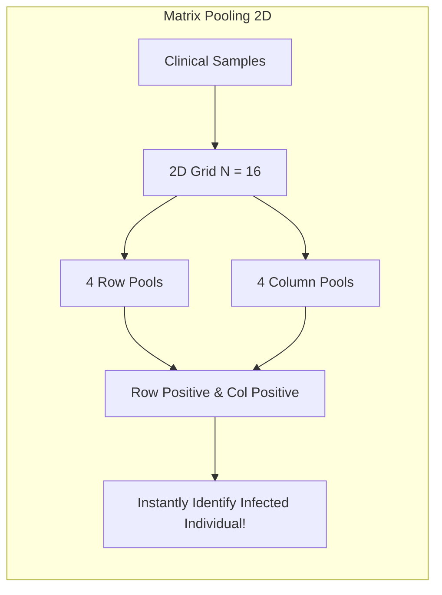

+++
title = "Group Testing #6: Connections to Compressed Sensing, Coding Theory, and Modern Applications"
slug = "connections-compressed-sensing-modern-applications"
date = '2026-10-16T10:25:00+07:00'
draft = true
tags = ["group-testing", "compressed-sensing", "covid-19", "coding-theory", "data-streams", "applications"]
categories = ["Mathematics", "Applications"]
math = true
description = "Exploring the grand synthesis: the bridge connecting Group Testing to Compressed Sensing, error-correcting codes, and breakthrough applications in COVID-19 PCR screening and Big Data."
summary = "Comparing Boolean algebra with compressive sensing over the real field, 1-bit Compressed Sensing, large-scale pandemic testing optimizations, and heavy-hitter algorithms in data streams."
+++

## 1. The Bridge Between Group Testing and Compressed Sensing

One of the most remarkable phenomena in modern applied mathematics is the profound convergence between two seemingly disparate domains: **Group Testing** and **Compressed Sensing (Compressive Sampling)**.

Both disciplines address the exact same philosophical question:
> **How can we reconstruct an intrinsically sparse signal in high-dimensional space $N$ using a sub-linear number of measurements $t$ ($t \ll N$)?**

The fundamental divergence lies in the algebraic nature of the measurement operator:

| Characteristic | Group Testing | Compressed Sensing |
| :--- | :--- | :--- |
| **Signal Domain** | Binary field $\mathbf{x} \in \{0, 1\}^N$ | Real / Complex field $\mathbf{x} \in \mathbb{R}^N$ |
| **Sparsity Character** | Exactly $d$ non-zero elements ($d \ll N$) | Exactly $k$ non-zero entries ($k \ll N$) |
| **Measurement Operator** | Boolean semiring: $\mathbf{y} = \mathbf{M} \odot \mathbf{x}$ (OR operator $\lor$) | Linear algebra: $\mathbf{y} = \mathbf{A}\mathbf{x}$ (inner products) |
| **Matrix Regularity** | $d$-disjunct / $d$-separable condition | Restricted Isometry Property (RIP) |
| **Decoding Regimes** | COMP, DD, SCOMP, Integer LP | $\ell_1$-minimization (Basis Pursuit, Lasso), OMP |

### 1.1. The Unifying Linchpin: 1-Bit Compressed Sensing

In 2008, Boufounos and Baraniuk introduced **1-Bit Compressed Sensing**:
$$
\mathbf{y} = \text{sign}(\mathbf{A}\mathbf{x})
$$
where real-valued measurements are quantized into binary signs ($\pm 1$). This framework builds a direct analytical bridge, translating continuous optimization tools from compressive sensing into discrete group testing formulations, and vice versa!

---

## 2. Intimate Ties to Error-Correcting Codes (Coding Theory)

Group testing can be formally interpreted as transmitting information across a spatial channel:
- Each candidate item $j$ is assigned a "codeword" comprising the $j$-th column of the measurement matrix: $\mathbf{m}_j \in \{0, 1\}^t$.
- The ensemble of columns forms a **Superimposed Code**, pioneered by Kautz & Singleton in the 1960s.
- Canonical coding schemes including **Reed-Solomon**, Hadamard matrices, and Low-Density Parity-Check (LDPC) bipartite graphs map directly to high-performance group testing matrices.

---

## 3. Real-World Impact in the COVID-19 Pandemic

During peak phases of the COVID-19 pandemic (2020–2022), global demand for RT-qPCR diagnostic kits overwhelmed laboratory capacity and supply chains. Mathematical epidemiologists deployed group testing directly on the frontlines:

1. **Dorfman Pooling (5-in-1, 10-in-1 Pools):** Widely adopted for community-wide epidemiological surveillance, conserving reagents by $70\%-85\%$.
2. **Matrix Pooling (2D Grid Testing):** Arranging 16 or 64 samples into a $4 \times 4$ or $8 \times 8$ grid. Rows and columns are pooled independently. When a single infection is present, the row-column intersection identifies the defective sample in a single round without follow-up tests!
3. **Hypercube Pooling & Tapestry:** Generalizing to multi-dimensional geometries (3D, 4D cubes) using COMP/SCOMP decoders to screen thousands of patient samples simultaneously.

---

## 4. Applications in Computer Science and Big Data

Beyond molecular biology, group testing is a foundational algorithmic primitive across computer systems:

### 4.1. Heavy Hitters in Streaming Algorithms

When network routers inspect millions of packets per second under strict RAM constraints:
- The vast majority of network flows carry minimal traffic.
- A handful of malicious or dominant IP addresses consume upwards of $80\%$ of bandwidth (Heavy Hitters or DDoS attacks).
- Algorithms like **Count-Min Sketch** and modern streaming sketches that hash items into small counter arrays are direct manifestations of random group testing matrices!

### 4.2. Medium Access Control (MAC) Conflict Resolution

In Wireless Sensor Networks (IoT), when multiple distributed nodes transmit concurrently across a shared radio frequency, packet collision occurs:
- A collision operates analogously to a Boolean OR: active transmissions yield channel busy ($1$), silence yields ($0$).
- Group testing enables the base station to resolve contenders and identify active transmitting sensors in minimum time slots.

### 4.3. Software Security and Malware Triage

Isolating which specific modules among millions of lines of source code harbor security vulnerabilities or backdoors without compiling and executing tests sequentially.

---

## 5. Epilogue to the Group Testing Series

Across this six-part journey, we traversed an inspiring mathematical landscape:
1. Originating from Dorfman's foundational insight in **1943**.
2. Attaining information-theoretic lower bounds with **Hwang's Binary Splitting**.
3. Structuring parallel measurements via **Disjunct Matrices** and finite fields.
4. Accelerating reconstruction with **COMP, DD, and SCOMP**.
5. Conquering operational uncertainty via **Noisy Models and Belief Propagation**.
6. Synthesizing links with **Compressed Sensing, Coding Theory, and Big Data**.

### Promising Open Research Frontiers
- Designing explicit, deterministic disjunct matrix constructions achieving optimal $O(d^2 \log N)$ scaling without randomized arguments.
- Designing provably optimal decoders under severely asymmetric channel noise and non-independent prior distributions.
- Leveraging group testing techniques for prompt injection detection and watermarking attribution in Large Language Models (LLMs).

---

## 6. Recommended Academic Reading

For researchers interested in deeper theoretical study:
- **Du, D. Z., & Hwang, F. K. (2000).** *Combinatorial Group Testing and Its Applications* (2nd ed.). World Scientific. *(The classic combinatorial authority).*
- **Aldridge, M., Johnson, O., & Scarlett, J. (2019).** *Group Testing: An Information Theory Perspective.* Foundations and Trends in Communications and Information Theory, 15(3-4), 196-392. *(The modern, comprehensive treatise through the information-theoretic lens).*
- **Foucart, S., & Rauhut, H. (2013).** *A Mathematical Introduction to Compressive Sensing.* Springer. *(Essential for mastering compressive sensing connections).*
