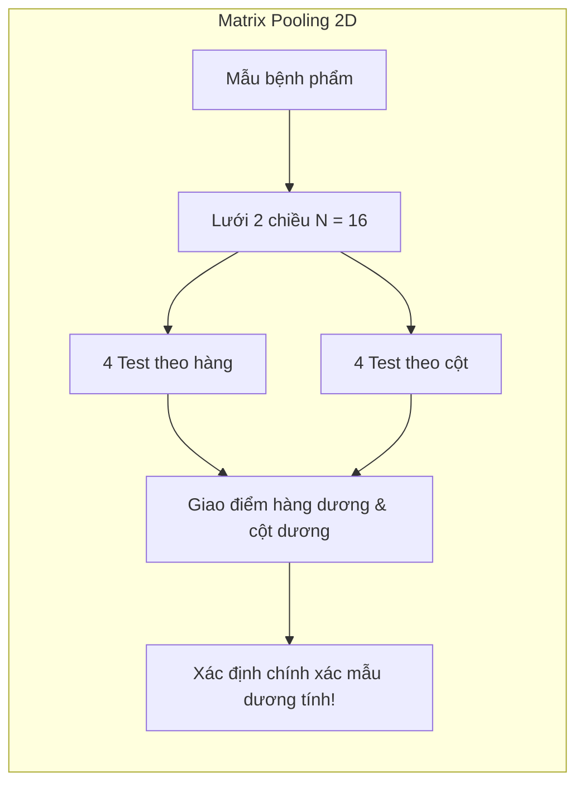

+++
title = "Group Testing #6: Mối liên hệ với Compressed Sensing, Mã hóa và Ứng dụng hiện đại"
slug = "moi-lien-he-compressed-sensing-va-ung-dung-hien-dai"
date = '2026-10-16T10:25:00+07:00'
draft = true
tags = ["group testing", "compressed sensing", "covid-19", "coding theory", "data streams", "ứng dụng"]
categories = ["Toán học", "Ứng dụng"]
math = true
description = "Khám phá bức tranh toàn cảnh: cây cầu nối giữa Group Testing và Compressed Sensing, lý thuyết mã sửa sai và các ứng dụng đột phá trong PCR COVID-19 và Dữ liệu lớn."
summary = "So sánh đại số Boolean với nén cảm nhận trên trường số thực, 1-bit Compressed Sensing, tối ưu hóa xét nghiệm PCR quy mô lớn trong đại dịch và thuật toán tìm phần tử trội (Heavy Hitters) trong luồng dữ liệu."
+++

## 1. Cây cầu nối giữa Group Testing và Compressed Sensing

Một trong những điều kỳ diệu nhất của toán học ứng dụng hiện đại là sự hội tụ bất ngờ giữa hai lĩnh vực tưởng chừng tách biệt: **Group Testing (Kiểm thử nhóm)** và **Compressed Sensing (Nén cảm nhận)**.

Cả hai lĩnh vực đều giải quyết cùng một câu hỏi triết học:
> **Làm thế nào để phục hồi một tín hiệu thưa (sparse signal) trong không gian số chiều rất lớn $N$ bằng một số lượng phép đo $t$ rất nhỏ ($t \ll N$)?**

Điểm khác biệt duy nhất nằm ở cấu trúc đại số của không gian đo:

| Đặc trưng | Group Testing (Kiểm thử nhóm) | Compressed Sensing (Nén cảm nhận) |
| :--- | :--- | :--- |
| **Không gian tín hiệu** | Nhị phân $\mathbf{x} \in \{0, 1\}^N$ | Số thực $\mathbf{x} \in \mathbb{R}^N$ |
| **Độ thưa (Sparsity)** | Có $d$ phần tử bằng $1$ ($d \ll N$) | Có $k$ phần tử khác $0$ ($k \ll N$) |
| **Phép toán đo** | Đại số Boolean: $\mathbf{y} = \mathbf{M} \odot \mathbf{x}$ (phép $\lor$) | Đại số tuyến tính: $\mathbf{y} = \mathbf{A}\mathbf{x}$ (phép cộng và tích vô hướng) |
| **Điều kiện ma trận** | Tính chất $d$-disjunct / $d$-separable | Tính chất đẳng cự giới hạn (Restricted Isometry Property - RIP) |
| **Giải mã** | COMP, DD, SCOMP, quy hoạch Boolean | Tối ưu hóa chuẩn $\ell_1$ (Basis Pursuit, Lasso), OMP |

### 1.1. Cầu nối: 1-Bit Compressed Sensing

Vào năm 2008, Boufounos và Baraniuk giới thiệu **1-Bit Compressed Sensing**:
$$
\mathbf{y} = \text{sign}(\mathbf{A}\mathbf{x})
$$
Trong đó các phép đo số thực bị lượng tử hóa thành đúng $1$ bit dấu ($\pm 1$). Đây chính là cây cầu giao thoa trực tiếp, mang các công cụ giải tích giải mã của Compressed Sensing sang giải quyết các bài toán của Group Testing và ngược lại!

---

## 2. Mối liên hệ mật thiết với Lý thuyết mã sửa sai (Coding Theory)

Group Testing thực chất có thể xem như bài toán truyền tin qua kênh không gian:
- Mỗi mẫu $j$ được gán một "từ mã" chính là cột thứ $j$ của ma trận đo: $\mathbf{m}_j \in \{0, 1\}^t$.
- Tập các từ mã tạo thành một **Superimposed Code** (mã xếp chồng), được Kautz & Singleton nghiên cứu từ những năm 1960.
- Các họ mã nổi tiếng như **Reed-Solomon**, mã Hadamard và mã đồ thị thưa (LDPC - Low-Density Parity-Check) đều được chuyển hóa trực tiếp thành các thiết kế ma trận đo group testing tối ưu.

---

## 3. Ứng dụng thực tiễn trong đại dịch COVID-19

Trong giai đoạn đỉnh điểm của đại dịch COVID-19 (2020 - 2022), nhu cầu xét nghiệm RT-PCR vượt xa công suất cung ứng hóa chất và máy tách chiết trên toàn cầu. Các nhà toán học và sinh học đã đưa Group Testing vào triển khai thực chiến:

1. **Dorfman Pooling (Gộp 5, Gộp 10):** Phương pháp phổ biến nhất tại Việt Nam và nhiều quốc gia để sàng lọc cộng đồng khi mở rộng diện truy vết.
2. **Matrix Pooling (Gộp 2 chiều):** Sắp xếp 16 hoặc 64 mẫu thành ma trận lưới vuông $4 \times 4$ hoặc $8 \times 8$. Thực hiện test theo từng hàng và từng cột. Nếu chỉ có 1 mẫu dương tính, giao điểm giữa hàng dương và cột dương lập tức chỉ ra mẫu bệnh phẩm đó mà không cần giai đoạn 2!
3. **Hypercube Pooling & Tapestry:** Mở rộng lên không gian đa chiều (3D, 4D cube) và sử dụng thuật toán giải mã COMP/SCOMP để xét nghiệm hàng nghìn mẫu trong một lần chạy duy nhất.

---

## 4. Ứng dụng trong Khoa học máy tính và Dữ liệu lớn (Big Data)

Không chỉ giới hạn trong y sinh, Group Testing là một công cụ nền tảng trong thiết kế thuật toán cho Big Data:

### 4.1. Tìm phần tử chiếm đa số (Heavy Hitters trong Data Streams)

Khi một router mạng phải phân tích hàng triệu gói tin mỗi giây với bộ nhớ hạn chế (chỉ vài megabyte RAM):
- Đa số các luồng truy cập chỉ có lưu lượng nhỏ.
- Một số ít địa chỉ IP chiếm tới $80\%$ băng thông (gọi là Heavy Hitters hoặc kẻ tấn công DoS).
- Thuật toán **Count-Min Sketch** và các thuật toán streaming hiện đại ánh xạ các IP vào các bộ đếm bằng hàm băm (hash functions) chính là hiện thân của thiết kế ma trận Group Testing ngẫu nhiên!

### 4.2. Giải quyết xung đột trong mạng không dây (MAC Conflict Resolution)

Trong mạng cảm biến không dây (IoT / Wireless Sensor Networks), khi nhiều trạm cùng phát sóng đồng thời trên một kênh tần số, tín hiệu sẽ bị xung đột (collision). 
- Xung đột hoạt động tương tự phép toán Boolean OR: Kênh có tín hiệu $= 1$, kênh yên lặng $= 0$.
- Áp dụng kiểm thử nhóm giúp trạm điều phối (Base Station) tìm ra chính xác những cảm biến nào đang có nhu cầu truyền tin trong thời gian ngắn nhất.

### 4.3. Quét mã độc và Bảo mật phần mềm

Xác định nhanh module nào trong hàng triệu dòng mã chứa lỗi bảo mật hoặc backdoor mà không cần biên dịch và kiểm thử từng hàm đơn lẻ.

---

## 5. Tổng kết chuỗi bài viết và Hướng nghiên cứu mở

Qua chuỗi 6 bài viết, chúng ta đã đi trọn một hành trình toán học kỳ thú:
1. Bắt đầu từ trực giác gộp mẫu đơn giản của **Dorfman (1943)**.
2. Chinh phục cận dưới thông tin với **Thuật toán chia nhị phân của Hwang**.
3. Thiết kế các phép đo song song qua **Ma trận Disjunct** và đại số tổ hợp.
4. Tối ưu hóa tốc độ khôi phục với **COMP, DD, SCOMP**.
5. Đương đầu với sai số bằng **Mô hình có nhiễu và Lan truyền niềm tin**.
6. Và cuối cùng, kết nối sâu sắc với **Compressed Sensing, Mã sửa sai và Big Data**.

### Các hướng nghiên cứu mở (Open Problems)
- Tìm các họ ma trận disjunct xác định (explicit / deterministic) đạt cận $O(d^2 \log N)$ mà không cần ngẫu nhiên hóa.
- Tối ưu hóa thuật toán giải mã trong điều kiện nhiễu phi đối xứng nặng và phân bố mẫu phi độc lập.
- Ứng dụng Group Testing trong việc phát hiện Prompt Injection và Watermarking trong các Mô hình ngôn ngữ lớn (LLMs).

---

## 6. Danh mục sách và tài liệu nghiên cứu chuyên sâu

Dành cho bạn đọc muốn đào sâu nghiên cứu học thuật:
- **Du, D. Z., & Hwang, F. K. (2000).** *Combinatorial Group Testing and Its Applications* (2nd ed.). World Scientific. *(Cuốn sách kinh điển gối đầu giường về mặt tổ hợp).*
- **Aldridge, M., Johnson, O., & Scarlett, J. (2019).** *Group Testing: An Information Theory Perspective.* Foundations and Trends® in Communications and Information Theory, 15(3-4), 196-392. *(Tài liệu hiện đại, toàn diện và sâu sắc nhất theo góc nhìn lý thuyết thông tin).*
- **Foucart, S., & Rauhut, H. (2013).** *A Mathematical Introduction to Compressive Sensing.* Springer. *(Để hiểu sâu mối liên hệ với Compressed Sensing).*
