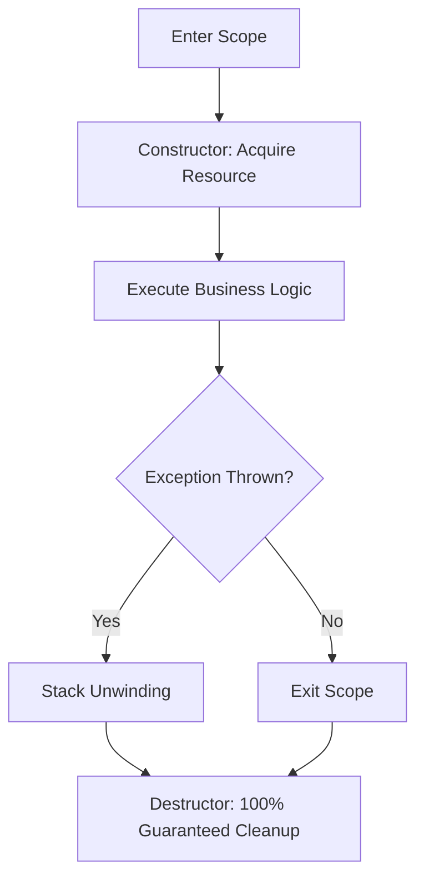

+++
title = "Modern C++ #1: Overview and Memory Architecture (Stack, Heap & RAII)"
slug = "modern-cpp-memory-model-raii"
date = '2026-10-16T10:31:00+07:00'
draft = true
tags = ["c++", "modern-cpp", "memory-model", "raii", "stack-heap"]
categories = ["Programming", "C++"]
description = "Uncovering the mechanics of C++ memory management: process address space architecture, Stack vs. Heap trade-offs, and the RAII idiom."
summary = "The transformation from C++98 to Modern C++, process virtual memory layouts, cost comparisons between Stack and Heap, and how RAII eliminates memory leaks without garbage collection overhead."
+++

## 1. The Renaissance of Modern C++

When people mention C++, many still recall the perils of legacy C++ (C++98/03):
- Risky manual memory management via naked `new` and `delete`.
- Frequent Segmentation Faults and Access Violations.
- Verbose type declarations and lack of modern functional idioms.

However, beginning with **C++11** and accelerating across **C++14, C++17, C++20, and C++23**, the language experienced a profound transformation known as **Modern C++**:
- **Safety First:** Dramatic reduction in raw pointers and manual deallocation.
- **Enhanced Expressiveness:** Automatic type deduction (`auto`), range-based `for` loops, Lambdas, `std::string_view`, and `std::optional`.
- **Supreme Performance:** Native move semantics, compile-time evaluation (`constexpr`), and Coroutines.

---

## 2. Process Memory Layout

To write optimal, bug-free C++ code, developers must understand how an OS maps a running process into virtual memory:

```text
+-----------------------------------+ 0xFFFFFFFF (High Address)
|           Kernel Space            | (Reserved for OS Kernel)
+-----------------------------------+
|               STACK               | <-- Grows downward (Fast, bounded size)
|                 |                 |
|                 v                 |
|                                   |
|                 ^                 |
|                 |                 |
|               HEAP                | <-- Grows upward (Dynamic, managed via new/malloc)
+-----------------------------------+
|         BSS (Uninitialized)       | (Zero-initialized global/static variables)
+-----------------------------------+
|      Data (Initialized)           | (Explicitly initialized global/static variables)
+-----------------------------------+
|         Text (Machine Code)       | (Read-only CPU instructions)
+-----------------------------------+ 0x00000000 (Low Address)
```

1. **Text Segment:** Stores the compiled machine instructions. Marked read-only to prevent runtime corruption.
2. **Data / BSS Segments:** Houses global variables and `static` data members.
3. **Stack:** High-speed storage for local scope variables and function call frames.
4. **Heap:** Dedicated pool for dynamic allocations whose lifetimes or sizes are determined at runtime.

---

## 3. In-Depth Comparison: Stack vs. Heap

| Metric | Stack | Heap |
| :--- | :--- | :--- |
| **Allocation Mechanism** | Decrement the Stack Pointer ($RSP$). Executed via a single CPU instruction (`sub rsp, bytes`). | Searches free memory blocks using allocators (ptmalloc, jemalloc, mimalloc). |
| **Speed** | **Instantaneous** (1–2 CPU clock cycles). | **Substantially slower** (heap metadata traversal; possible `brk`/`mmap` system calls). |
| **Reclamation** | **Completely automatic** upon scope exit (`{ }`). | **Requires explicit deallocation** or wrapper object management. |
| **Capacity** | Strictly bounded (typically 1MB–8MB). Exceeding capacity causes **Stack Overflow**. | Bounded only by physical RAM and virtual swap capacity. |
| **Cache Locality** | Contiguous cache-friendly layout maximizing L1/L2/L3 cache line utilization. | Prone to spatial fragmentation and pointer indirection overhead. |

> **The Golden Rule:** Always favor **Stack** allocations. Resort to the **Heap** only when:
> 1. The object payload is large enough to risk a stack overflow.
> 2. The allocation size is variable and discovered at runtime.
> 3. The object's lifecycle must outlive the scope that created it.

---

## 4. Pointers vs. References

In C++, pointers and references are frequently contrasted. Let us distinguish their mechanics:

```cpp
int a = 42;

// Pointer: a distinct variable holding the memory address of another object
int* ptr = &a; 
*ptr = 100; // Modifies 'a' via dereference

// Reference: a direct alias bound to 'a'
int& ref = a; 
ref = 200; // Modifies 'a' directly
```

| Trait | Pointer | Reference |
| :--- | :--- | :--- |
| **Initialization** | May be left uninitialized or set to `nullptr`. | **Must** bind to a valid existing object upon declaration. |
| **Rebinding** | Can be reassigned to target other memory locations. | **Immutable binding**; cannot refer to another object once bound. |
| **Access Syntax** | Requires dereference operator `*` or arrow `->`. | Accessed naturally like regular variables via dot operator `.`. |

---

## 5. The Paramount C++ Philosophy: RAII

**RAII** stands for **Resource Acquisition Is Initialization**.

Pioneered by **Bjarne Stroustrup**, it forms the foundational design paradigm of idiomatic C++:

> **The RAII Invariant:**
> 1. Every resource (heap allocations, file handles, network sockets, mutex locks) must be encapsulated within a **Stack-allocated** managing object.
> 2. The object's **Constructor** acquires and initializes the underlying resource.
> 3. The object's **Destructor** automatically releases the resource on scope exit, regardless of whether exit occurs cleanly or via an uncaught exception (`throw std::exception`).



### Self-Managing File Handle Under RAII

```cpp
#include <iostream>
#include <fstream>
#include <string>

class FileHandler {
private:
    std::FILE* m_file;

public:
    // 1. Constructor: Acquire resource
    explicit FileHandler(const char* filepath, const char* mode) {
        m_file = std::fopen(filepath, mode);
        if (!m_file) {
            throw std::runtime_error("Failed to open file!");
        }
        std::cout << "[RAII] File successfully opened.\n";
    }

    // 2. Destructor: Automatic cleanup on scope exit
    ~FileHandler() {
        if (m_file) {
            std::fclose(m_file);
            std::cout << "[RAII] File closed safely via Destructor!\n";
        }
    }

    // Disable copy operations to prevent double-close bugs (Rule of Three)
    FileHandler(const FileHandler&) = delete;
    FileHandler& operator=(const FileHandler&) = delete;

    void write(const std::string& text) {
        std::fputs(text.c_str(), m_file);
    }
};

void run_example() {
    FileHandler my_file("log.txt", "w");
    my_file.write("Hello Modern C++!");
    // Even if an exception is thrown here, the file is guaranteed to close safely!
} // my_file is automatically destroyed here
```

Through RAII, C++ achieves the holy grail: **100% deterministic, automated resource management matching garbage-collected runtimes (Java, C#, Go), with zero Garbage Collection pause overhead!**

---

## 6. Summary and Next Steps

Mastering Stack/Heap boundaries and internalizing RAII is the pivotal leap distinguishing developers writing "C with classes" from true Modern C++ systems engineers.

In [Article 2: Move Semantics, Rvalue References, and Smart Pointers](../move-semantics-smart-pointers/), we explore how Modern C++ standardizes RAII via `std::unique_ptr`, `std::shared_ptr`, and ownership transfer via move semantics.
