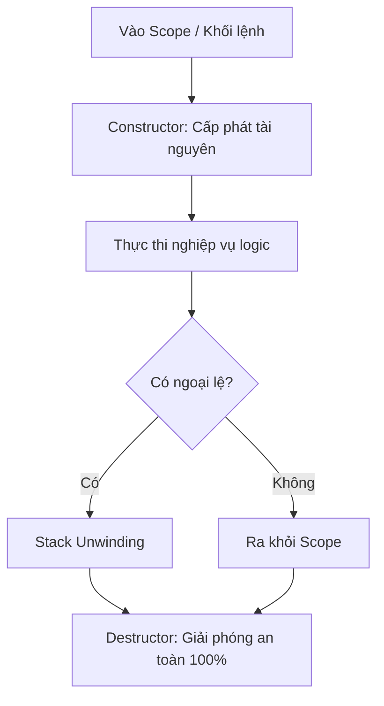

+++
title = "Modern C++ #1: Tổng quan và Mô hình Quản lý Bộ nhớ (Stack, Heap & RAII)"
date = '2026-10-16T10:31:00+07:00'
draft = true
tags = ["c++", "modern c++", "memory model", "raii", "stack-heap"]
categories = ["Lập trình", "C++"]
description = "Khám phá bản chất quản lý bộ nhớ trong C++: kiến trúc không gian địa chỉ, so sánh Stack vs Heap và triết lý tối thượng RAII."
summary = "Sự chuyển mình từ C++98 sang Modern C++, mô hình vùng nhớ ảo của tiến trình (Virtual Memory Space), so sánh chi phí Stack vs Heap và cách triết lý RAII giải quyết bài toán rò rỉ bộ nhớ mà không cần Garbage Collector."
+++

## 1. Sự chuyển mình sang Modern C++

Khi nhắc đến C++, nhiều người vẫn còn ám ảnh bởi những dòng mã C++ cổ điển (C++98/03):
- Quản lý bộ nhớ thủ công đầy rủi ro với `new` và `delete`.
- Lỗi phân đoạn (Segmentation Fault / Access Violation) xảy ra thường xuyên.
- Cú pháp dài dòng, thiếu các cấu trúc hàm tiện ích hiện đại.

Tuy nhiên, bắt đầu từ **C++11** và tiếp tục mở rộng mạnh mẽ qua **C++14, C++17, C++20 và C++23**, C++ đã trải qua một cuộc cách mạng được gọi là **Modern C++**:
- **An toàn hơn:** Hạn chế tối đa việc sử dụng con trỏ thô (raw pointers) và cấp phát thủ công.
- **Trực quan hơn:** Tự suy luận kiểu với `auto`, vòng lặp theo phạm vi (range-based for), biểu thức Lambda, `std::string_view`, và `std::optional`.
- **Hiệu năng đỉnh cao:** Đưa Move Semantics, biểu thức thời gian biên dịch (`constexpr`), và Coroutines vào ngôn ngữ.

---

## 2. Bản đồ không gian địa chỉ bộ nhớ (Process Memory Layout)

Để viết mã C++ hiệu quả và không gặp lỗi undefined behavior, lập trình viên cần hiểu tiến trình của mình được bố trí trên bộ nhớ như thế nào:

```text
+-----------------------------------+ 0xFFFFFFFF (Địa chỉ cao)
|           Kernel Space            | (Vùng dành cho nhân HĐH)
+-----------------------------------+
|               STACK               | <-- Tăng dần xuống dưới (vùng nhớ nhanh, kích thước cố định)
|                 |                 |
|                 v                 |
|                                   |
|                 ^                 |
|                 |                 |
|               HEAP                | <-- Tăng dần lên trên (vùng nhớ động, quản lý qua new/malloc)
+-----------------------------------+
|         BSS (Chưa khởi tạo)       | (Biến static/toàn cục khởi tạo mặc định bằng 0)
+-----------------------------------+
|      Data (Đã khởi tạo)           | (Biến static/toàn cục có giá trị ban đầu)
+-----------------------------------+
|         Text (Mã máy / Code)      | (Các chỉ lệnh CPU ở chế độ chỉ đọc)
+-----------------------------------+ 0x00000000 (Địa chỉ thấp)
```

1. **Text Segment:** Chứa mã máy thực thi nhị phân. Vùng này chỉ đọc (read-only) để tránh bị sửa đổi ngoài ý muốn.
2. **Data / BSS Segment:** Lưu trữ các biến toàn cục (global variables) và biến tĩnh (`static`).
3. **Stack (Ngăn xếp):** Vùng nhớ lưu trữ các biến cục bộ (local variables) và con trỏ khung hàm (stack frames).
4. **Heap (Đống):** Vùng nhớ phục vụ cho việc cấp phát động (dynamic memory allocation) khi kích thước dữ liệu chỉ được biết trong lúc chạy.

---

## 3. So sánh chuyên sâu: Stack vs Heap

| Tiêu chí | Stack | Heap |
| :--- | :--- | :--- |
| **Cơ chế cấp phát** | Di chuyển con trỏ ngăn xếp (Stack Pointer - $RSP$). Cấp phát bằng 1 chỉ lệnh CPU duy nhất (`sub rsp, bytes`). | Phải tìm khối nhớ trống thích hợp qua trình quản lý bộ nhớ (ptmalloc, jemalloc, mimalloc). |
| **Tốc độ** | **Cực nhanh** (thường chỉ mất 1-2 chu kỳ CPU). | **Chậm hơn nhiều** (phải duyệt danh sách khối nhớ, có thể kích hoạt system call `brk`/`mmap`). |
| **Quản lý thu hồi** | **Tự động hoàn toàn** khi ra khỏi phạm vi khối lệnh (`{ }`). | **Phải giải phóng thủ công** hoặc qua lớp bao bọc đối tượng. |
| **Kích thước** | Bị giới hạn (thường là 1MB - 8MB tùy OS). Vượt quá sẽ gây lỗi **Stack Overflow**. | Giới hạn bởi dung lượng RAM vật lý và vùng nhớ ảo (Virtual Memory Swap). |
| **Tính cục bộ bộ nhớ (Cache Locality)** | Rất cao do dữ liệu nằm liền kề, tận dụng tối đa L1/L2/L3 Cache của CPU. | Kém hơn, dễ bị phân mảnh bộ nhớ (Fragmentation). |

> **Nguyên tắc vàng:** Ưu tiên tối đa việc phân bổ đối tượng trên **Stack**. Chỉ dùng **Heap** khi:
> 1. Kích thước đối tượng quá lớn có nguy cơ gây tràn ngăn xếp.
> 2. Kích thước dữ liệu chỉ xác định được lúc chạy (runtime-sized array).
> 3. Vòng đời của đối tượng vượt qua phạm vi của hàm tạo ra nó.

---

## 4. Con trỏ (Pointers) vs Tham chiếu (References)

Trong C++, con trỏ và tham chiếu thường xuyên được so sánh. Hãy phân biệt rõ bản chất:

```cpp
int a = 42;

// Con trỏ (Pointer): là một biến lưu trữ địa chỉ vùng nhớ khác
int* ptr = &a; 
*ptr = 100; // Thay đổi giá trị a qua giải tham chiếu

// Tham chiếu (Reference): là một "bí danh" (alias) trực tiếp của a
int& ref = a; 
ref = 200; // Thay đổi trực tiếp a
```

| Đặc điểm | Con trỏ (Pointer) | Tham chiếu (Reference) |
| :--- | :--- | :--- |
| **Khởi tạo** | Có thể để trống hoặc gán `nullptr`. | **Bắt buộc** phải được khởi tạo với một đối tượng hợp lệ ngay lúc khai báo. |
| **Gán lại mục tiêu** | Có thể trỏ sang đối tượng khác bất kỳ lúc nào. | **Không thể đổi mục tiêu** sau khi đã liên kết. |
| **Cú pháp truy cập** | Cần toán tử `*` hoặc `->`. | Truy cập tự nhiên như biến thông thường bằng toán tử `.`. |

---

## 5. Triết lý tối thượng của C++: RAII

**RAII** là viết tắt của **Resource Acquisition Is Initialization** (Thu nhận tài nguyên chính là lúc khởi tạo).

Đây là nguyên lý thiết kế quan trọng bậc nhất của C++, do chính nhà sáng lập **Bjarne Stroustrup** khởi xướng:

> **Quy tắc RAII:**
> 1. Mọi tài nguyên (vùng nhớ heap, file handle, socket mạng, database lock) phải được đóng gói bên trong một đối tượng trên **Stack**.
> 2. **Hàm khởi tạo (Constructor)** của đối tượng chịu trách nhiệm yêu cầu và cấp phát tài nguyên.
> 3. **Hàm hủy (Destructor)** của đối tượng chịu trách nhiệm tự động giải phóng tài nguyên khi đối tượng ra khỏi tầm vực (scope exit), bất kể thoát hàm bình thường hay do gặp Ngoại lệ (`throw std::exception`).



### Minh họa một lớp RAII tự quản lý file

```cpp
#include <iostream>
#include <fstream>
#include <string>

class FileHandler {
private:
    std::FILE* m_file;

public:
    // 1. Constructor: Mở tài nguyên
    explicit FileHandler(const char* filepath, const char* mode) {
        m_file = std::fopen(filepath, mode);
        if (!m_file) {
            throw std::runtime_error("Không thể mở tập tin!");
        }
        std::cout << "[RAII] Đã mở file thành công.\n";
    }

    // 2. Destructor: Tự động giải phóng khi ra khỏi scope
    ~FileHandler() {
        if (m_file) {
            std::fclose(m_file);
            std::cout << "[RAII] Đã đóng file tự động qua Destructor!\n";
        }
    }

    // Vô hiệu hóa việc copy để tránh double close (Rule of Three)
    FileHandler(const FileHandler&) = delete;
    FileHandler& operator=(const FileHandler&) = delete;

    void write(const std::string& text) {
        std::fputs(text.c_str(), m_file);
    }
};

void run_example() {
    FileHandler my_file("log.txt", "w");
    my_file.write("Xin chào Modern C++!");
    // Dù có throw exception ở đây, file vẫn luôn được đóng an toàn nhờ Destructor!
} // my_file tự động bị hủy tại đây
```

Nhờ có RAII, C++ đạt được sự cân bằng hoàn hảo: **Quản lý bộ nhớ an toàn và tự động 100% như các ngôn ngữ có Garbage Collector (Java, C#, Go), nhưng hoàn toàn không tốn chi phí dừng chương trình (Stop-the-World latency) của Garbage Collector!**

---

## 6. Lời kết và Bài tiếp theo

Hiểu rõ mô hình bộ nhớ Stack/Heap và thấm nhuần tư tưởng RAII là bước đệm then chốt đưa bạn từ một người "viết mã C trong trình biên dịch C++" trở thành một kỹ sư C++ chuyên nghiệp.

Trong **[Bài 2: Move Semantics, Rvalue References và Con trỏ thông minh (Smart Pointers)]()**, chúng ta sẽ xem cách Modern C++ hiện thực hóa RAII một cách tuyệt đối qua `std::unique_ptr`, `std::shared_ptr` và cơ chế chuyển quyền sở hữu (Move Semantics).
