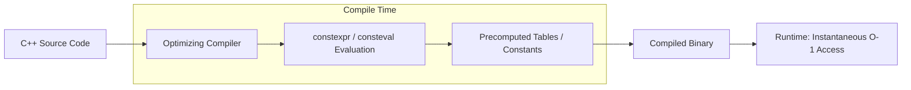

+++
title = "Modern C++ #6: Performance Optimization: Compile-Time Evaluation, Zero-Cost Abstractions, and Tooling"
date = '2026-10-16T10:36:00+07:00'
draft = true
tags = ["c++", "performance", "constexpr", "consteval", "sanitizers", "cmake", "tooling"]
categories = ["Programming", "C++"]
description = "Peak optimization techniques in Modern C++: shifting execution to compile-time via constexpr/consteval, copy elision (RVO), and modern diagnostic tooling."
summary = "Bjarne Stroustrup's zero-cost abstraction principle, precomputing logic with constexpr and consteval, guaranteed copy elision, and the Sanitizer ecosystem (ASan, TSan)."
+++

## 1. Bjarne Stroustrup's "Zero-Cost Abstraction" Principle

The creator of C++, **Bjarne Stroustrup**, formulated the foundational engineering creed of the language through two classic dictums:
> 1. *What you don't use, you don't pay for.*
> 2. *What you do use, you couldn't hand code any better.*

This means that high-level abstractions in Modern C++ (such as Smart Pointers, Lambdas, Ranges, and Structured Bindings), when passed through an optimizing compiler (`-O3`), dissolve entirely into minimal, vectorized machine instructions without imposing any runtime penalty over handcrafted assembly.

---

## 2. Compile-Time Computation: The Ultimate Optimization

The most effective runtime optimization technique is remarkably simple: **Perform zero computation at runtime by precomputing everything 100% during compilation!**



### 2.1. `constexpr` (C++11 $\to$ C++20)

The `constexpr` specifier declares that a function or expression is *eligible* for evaluation at compile time when all inputs are compile-time constants:

```cpp
#include <iostream>

// Factorial evaluated entirely at compile time!
constexpr uint64_t factorial(uint64_t n) {
    return (n <= 1) ? 1 : (n * factorial(n - 1));
}

int main() {
    // The compiler precomputes 10! = 3628800 and embeds the constant directly in assembly
    constexpr uint64_t result = factorial(10);
    std::cout << "10! = " << result << "\n";
}
```

### 2.2. `consteval` — Immediate Functions in C++20

Unlike `constexpr` (which gracefully degrades to runtime execution when passed variable inputs), **`consteval`** enforces an absolute mandate:
*This function MUST evaluate at compile time. If compile-time evaluation fails, compilation aborts immediately with an error!*

```cpp
consteval int square(int n) {
    return n * n;
}

int main() {
    constexpr int val = square(5); // VALID: Evaluated during compilation

    int x = 5;
    // int val2 = square(x); // COMPILE ERROR: 'x' is not a compile-time constant!
}
```

### 2.3. `constinit` in C++20
Guarantees that a variable with static or thread-local storage duration is initialized with a compile-time constant, eliminating the dreaded **Static Initialization Order Fiasco** across independent translation units.

---

## 3. Implicit Compiler Optimizations: RVO and NRVO

Developers often hesitate to return large objects by value, falling back on legacy C-style output parameters: `void get_data(MyObject* out)`. In Modern C++, this style is obsolete thanks to:

### Return Value Optimization (RVO / NRVO)
When returning a local object by value:
```cpp
std::string get_greeting() {
    std::string msg = "Greetings to C++ systems engineers!";
    return msg; 
}

std::string str = get_greeting();
```

The optimizing compiler applies **Copy Elision**:
It constructs `msg` **directly inside the memory allocated for `str` on the caller's stack frame**!
The result: **Zero copy constructors invoked, and zero move constructors required!** The abstraction cost is strictly $0$.

Since C++17, RVO for unnamed temporaries is a **mandatory compiler constraint (Guaranteed Copy Elision)** for all conforming compilers.

---

## 4. Modern Diagnostic Tooling Ecosystem

Modern C++ development relies on an ecosystem of diagnostic instrumentation to preempt memory bugs and profile bottlenecks:

### 4.1. Compiler Explorer (Godbolt.org)
The online platform [godbolt.org](https://godbolt.org/) is indispensable for systems programming. It allows you to inspect real-time generated assembly (x86, ARM, RISC-V) across GCC, Clang, and MSVC side-by-side with source code.

### 4.2. The LLVM / GCC Sanitizer Suite
No complex external setup required; simply append compiler flags:
1. **AddressSanitizer (`-fsanitize=address`):** Detects out-of-bounds array access (Buffer Overflow), Use-After-Free, and memory leaks with minimal execution overhead (roughly $2\times$ slowdown, $10\times$ faster than Valgrind!).
2. **ThreadSanitizer (`-fsanitize=thread`):** Catches data races in multithreaded code.
3. **UndefinedBehaviorSanitizer (`-fsanitize=undefined`):** Traps integer overflows, division by zero, and invalid pointer casts at runtime.

### 4.3. Modern Build Systems and Package Managers
- **Modern Target-Based CMake:** Employs modular targets (`target_link_libraries()`, `target_include_directories()`) rather than outdated global directory mutations.
- **Package Managers:** **vcpkg** or **Conan** enable cross-platform dependency integration (Boost, nlohmann/json, fmt, gtest) with declarative manifests.

---

## 5. Recommended Canonical Reading

To continue advancing your C++ systems engineering expertise:
1. **"Effective Modern C++"** — *Scott Meyers* (42 actionable guidelines for navigating C++11 and C++14).
2. **"C++ Concurrency in Action"** — *Anthony Williams* (The definitive treatise on multithreading from a C++ standards committee member).
3. **"A Tour of C++" (3rd Edition - C++20)** — *Bjarne Stroustrup* (An authoritative, high-density overview penned by the language's creator).

---

## 6. Epilogue to the Modern C++ Series

From mastering Stack and Heap memory boundaries, governing resource lifecycles through Move Semantics and Smart Pointers, crossing into compile-time polymorphism with Concepts, to squeezing every clock cycle from multi-core processors — Modern C++ offers a programming paradigm that is expressive, safe, and blazingly fast.

Happy engineering with Modern C++!
